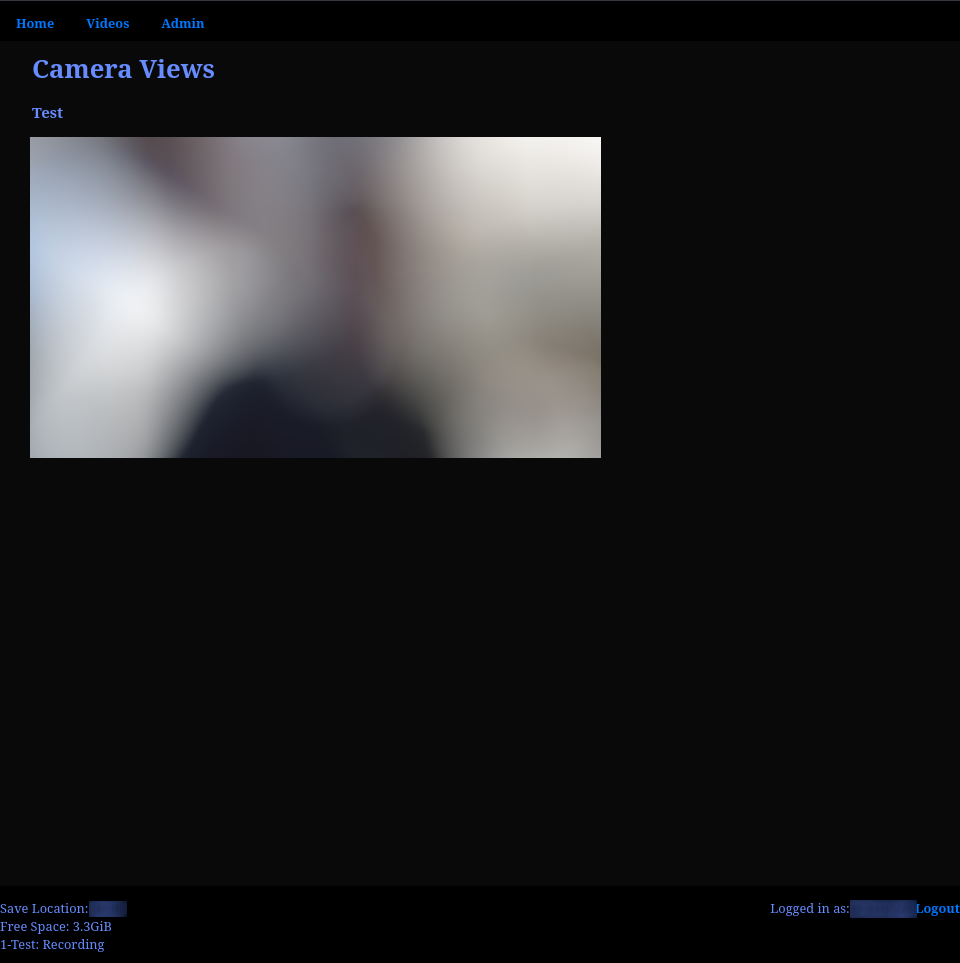

# A simple home camera recorder/viewer.


TODO: UPDATES BELOW HERE


This is a simple camera recording and display implementation using Python/Flask/SQLite. I built this because I wanted to host my own recording for my home security cameras, and felt like the existing open source software that I could find was bigger/heavier than I wanted. I run this on a Raspberry Pi.

## Installation

Designed to be hosted on a RPi device. 
Make sure that the following packages are installed on your RPi:
- python3-bcrypt
- python3-flask
- python3-flask-login
- python3-opencv
- gunicorn
- nginx
- supervisor
- ffmpeg

Copy the contents of the src/ folder to your directory structure.
Make sure that the user:group of the /srv/http folder is www-user
Restart nginx and supervisor services.

To check on status in terminal:
```bash
sudo systemctl status nginx
sudo systemctl status supervisor
sudo supervisorctl status all
```
## Usage
- In a browser, go to your server's address.
- The first time you visit, the app will have you create an admin account
- Click on 'Admin' to configure what cameras you have. Note that this accesses the cameras through URLs, so you need to figure out a fully formed URL for both the video stream and to capture a still.
